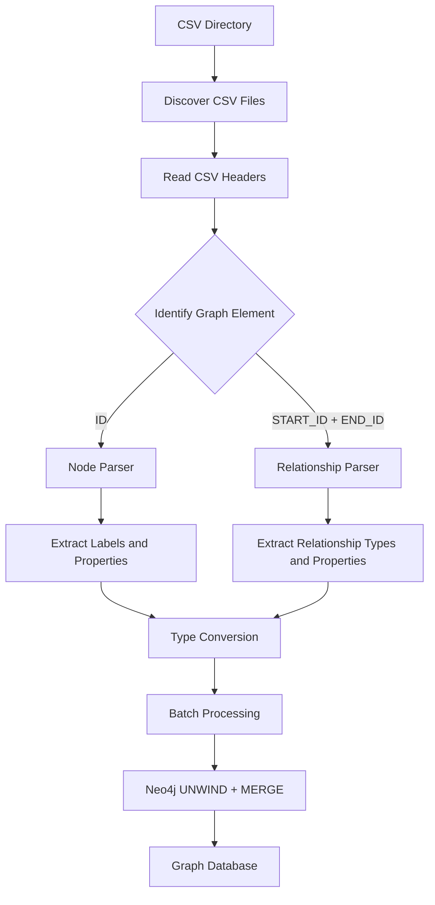
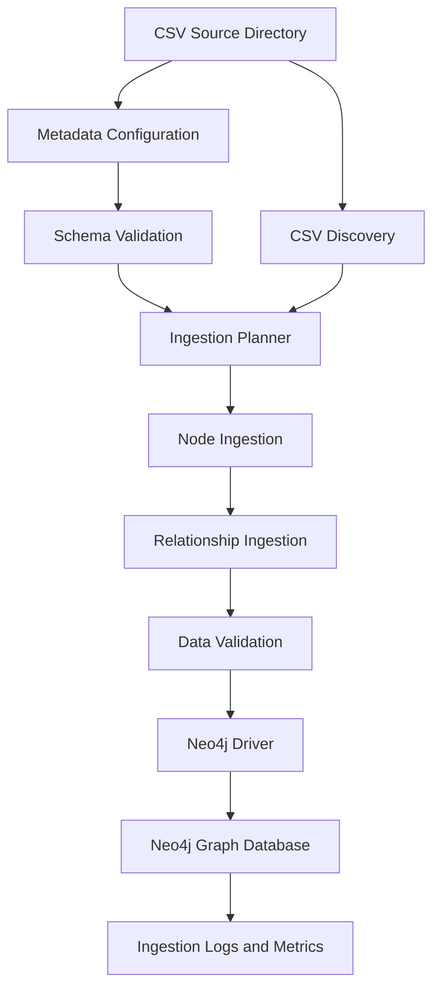
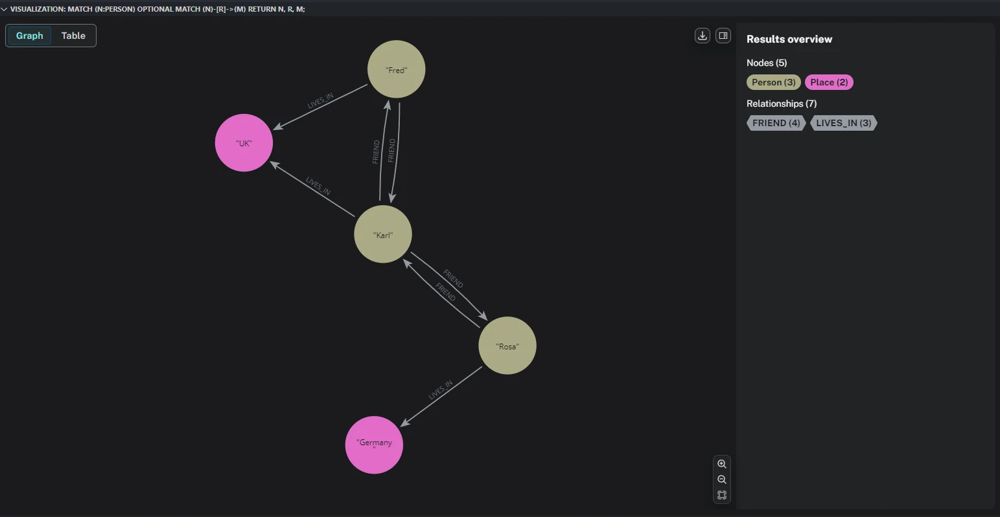

---
# Feel free to add content and custom Front Matter to this file.
# To modify the layout, see https://jekyllrb.com/docs/themes/#overriding-theme-defaults

layout: default
title: CSV to Graph Ingestion
parent: Graph
grand_parent: Data Engineering
permalink: /data engineering/graph/ingestion/
nav_order: 100
---

# CSV to Graph Ingestion

data engineering
{: .badge .badge-pill .badge-primary }
graph
{: .badge .badge-pill .badge-secondary }
csv
{: .badge .badge-pill .badge-info }


# Overview
CSV is one of the most common formats for exchanging and storing structured data. It provides a simple way to organize information into rows and columns, making it suitable for datasets exported from databases, business applications, analytical platforms, and other data sources.

However, when working with Neo4j, importing CSV files involves more than simply transferring rows into a database. The data must be translated into a graph structure consisting of nodes, relationships, and properties. Each entity must have an identifiable key, and relationships must correctly connect the corresponding nodes.

For example, a collection of CSV files containing people, places, and their connections can be transformed into a graph where Person and Place become nodes, while relationships such as FRIEND and LIVES_IN describe how those entities are connected.

A well-designed ingestion process should address several considerations:
- **Data structure**: Identify node labels, relationship types, unique identifiers, and property definitions.
- **Data transformation**: Convert CSV values into appropriate Neo4j property types, handle missing values, and standardize inconsistent records.
- **Relationship integrity**: Ensure that relationship endpoints reference existing nodes.
- **Data consistency**: Prevent unintended duplicates and maintain consistent identifiers across datasets.
- **Scalability**: Process large CSV files efficiently through batch operations rather than inserting individual records one at a time.

The ingestion process can be implemented using the `Neo4j Python Driver`, `native Cypher LOAD CSV`, or a `combination of both`. Python provides flexibility for orchestration, validation, and transformation, while Cypher provides direct access to Neo4j's graph operations.

The choice of implementation should depend on the complexity of the data, the number of CSV files, and whether the ingestion process needs to support different schemas without modifying the underlying code.

## Ingestion Approaches
There are two practical approaches to implementing CSV ingestion with Python: **function-based ingestion** and **metadata-driven ingestion**.

1. Function-Based Ingestion

    Function-based ingestion uses dedicated Python functions to process specific data structures. Each function defines how a particular CSV file should be read, transformed, and inserted into Neo4j.

    For example, separate functions can handle person nodes, place nodes, and relationships between people or places. The ingestion logic is explicitly defined in the Python code, including the target node labels, relationship types, identifiers, and property mappings.

    This approach is straightforward and provides direct control over the ingestion process. It works well when the data structure is relatively stable, the number of CSV files is limited, and each dataset requires specific transformation logic.

    The main limitation is maintainability. When new datasets or relationship types are introduced, developers may need to create or modify additional functions. As the number of data sources grows, ingestion logic can become repetitive and harder to manage.

2. Metadata-Driven Ingestion

    Metadata-driven ingestion separates the ingestion configuration from the execution logic. Instead of defining every dataset directly in Python functions, the structure of each CSV file is described through external metadata, such as a JSON configuration file.

    The metadata defines information such as:
       - CSV filename and file location.
       - Node labels and relationship types.
       - Unique identifier columns.
       - Source and target node definitions.
       - Property mappings and data types.
       - Batch size and ingestion settings.

    A generic ingestion engine reads this configuration and uses it to determine how each dataset should be processed and loaded into Neo4j.

    This approach reduces repetitive code and makes the ingestion process easier to extend. Adding a new dataset generally requires updating the metadata configuration rather than writing another ingestion function.

    It is particularly useful when handling multiple CSV files with different structures, recurring data imports, or ingestion pipelines that need to be maintained across different projects.


# Function-Based Ingestion
For a general-purpose CSV-to-Neo4j ingestion pipeline, we could using the **Neo4j Python Driver (neo4j)** with **Pandas**.

The objective is to build a reusable ingestion process that can handle:
1. Multiple CSV files representing different node labels.
2. Multiple CSV files representing different relationship types.
3. Dynamic node properties (e.g., name, city, country).
4. Dynamic relationship properties (e.g., since, role, weight).
5. Neo4j identifiers such as :ID(Person), :START_ID(Person), and :END_ID(Place).
6. Different data types, including strings, integers, floats, booleans, and dates.
7. Batch processing for large CSV files.

## Example CSV structure
The csv file could be stored like example below:

1. people.csv

```csv
:ID(Person),name
23,Rosa
42,Karl
55,Fred
```

2. places.csv

```csv
:ID(Place),city,country
143,Berlin,Germany
244,London,UK
```

3. live_in.csv

```csv
:START_ID(Person),:END_ID(Place),since
23,143,2020
55,244
42,244,1980
```

4. friends.csv

```csv
:START_ID(Person),:END_ID(Person)
23,42
42,23
42,55
55,42
```

In general, the files describe two node labels and two relationship types.

| CSV          | Graph element          | Identifier / relationship          |
| ------------ | ---------------------- | ---------------------------------- |
| person.csv   | Node: Person           | :ID(Person)                        |
| place.csv    | Node: Place            | :ID(Place)                         |
| friend.csv   | Relationship: FRIEND   | :START_ID(Person), :END_ID(Person) |
| lives_in.csv | Relationship: LIVES_IN | :START_ID(Person), :END_ID(Place)  |

The important distinction is:
- :ID(Label) identifies a node.
- :START_ID(Label) identifies the source node.
- :END_ID(Label) identifies the target node.
- Other columns become properties of nodes or relationships.

## The ingestion process



The main design principle is to separate:
- Metadata parsing: identify labels, relationship types, IDs and properties.
- Data transformation: convert CSV values into Python data types.
- Database ingestion: dynamically generate parameterized Cypher queries.
- Batch processing: insert records in manageable transactions.

## Detail Functions
- Import libraries and configure Neo4j

```python
import os
import re
import csv
import math

from pathlib import Path
from datetime import date, datetime
from dotenv import load_dotenv
from neo4j import GraphDatabase

load_dotenv()

NEO4J_URI = os.getenv("NEO4J_URI")
NEO4J_USERNAME = os.getenv("NEO4J_USERNAME")
NEO4J_PASSWORD = os.getenv("NEO4J_PASSWORD")
NEO4J_DATABASE = os.getenv("NEO4J_DATABASE", "neo4j")

driver = GraphDatabase.driver(NEO4J_URI,auth=(NEO4J_USERNAME, NEO4J_PASSWORD))
driver.verify_connectivity()
```

- Parse CSV headers automatically
  - `parse_header(header)`
  - The parser detects the following header patterns, such as: `:ID(Person)`, `:START_ID(Person)`, `:END_ID(Place)` etc.
- Convert properties into Python data types
  - `convert_value(value, data_type)`
  - `clean_properties(row, metadata)`
  - Convert properties into Python data types before inserting them.
  - Extract and convert CSV properties.
- Build the generic ingestion engine
  - `validate_identifier(value)`
  - `read_csv_batches(file_path, batch_size=5000)`
  - `ingest_nodes(session, metadata, records, batch_size=5000)`
  - `ingest_relationships(session,metadata,records,default_type,batch_size=5000)`
- Create the main ingestion function
  - This function automatically discovers CSV files and determines which ingestion function to execute.
  - `ingest_csv_directory(directory,batch_size=5000)`
- Create uniqueness constraints
  - For production ingestion, create uniqueness constraints before loading data.
  - This ensures that each node has a unique id within its label.
  - `create_constraints(labels)`

## Output

```
Processing: friend.csv
Completed: friend.csv | Records: 1 | Type: relationship

Processing: lives_in.csv
Completed: lives_in.csv | Records: 1 | Type: relationship

Processing: person.csv
Completed: person.csv | Records: 1 | Type: node

Processing: place.csv
Completed: place.csv | Records: 2 | Type: node

Loading nodes: people.csv
Loading nodes: places.csv
Loading relationships: friends.csv
Loading relationships: lives_in.csv

Neo4j CSV ingestion completed.
```

## Verify the ingested graph
After ingestion, run the following queries in Neo4j Browser.

```cypher
MATCH (n)
RETURN labels(n) AS labels,
    properties(n) AS properties;
```

Visualize the complete graph:

```cypher
MATCH (a)-[r]->(b)
RETURN a, r, b;
```

# Metadata-Driven Ingestion
For a more scalable architecture, we would eventually separate the ingestion metadata from the CSV files themselves. This method also called **configuration-driven graph ETL pipeline**.

Instead of relying entirely on CSV headers to determine graph structures, the ingestion engine will use a central metadata configuration to control:
- Node labels and primary keys.
- Relationship types and source/target labels.
- CSV column mappings.
- Property names and data types.
- Node and relationship uniqueness.
- Ingestion dependencies and execution order.
- Batch sizes and validation rules.
- Incremental loading and error handling.

The key difference is that the ingestion engine becomes independent of the actual dataset. To ingest a new entity or relationship, you only need to add its metadata configuration.


## The ingestion process



The architecture separates three responsibilities:

| Component        | Responsibility                              |
| ---------------- | ------------------------------------------- |
| Metadata         | Defines graph schema and CSV mappings       |
| Ingestion engine | Reads, transforms, validates and loads data |
| Neo4j driver     | Executes parameterized Cypher transactions  |

## Project structure

```
neo4j_csv_ingestion/
│
├── config/
│   ├── schema.json
│   └── .env
│
├── data/
│   ├── person.csv
│   ├── place.csv
│   ├── friend.csv
│   └── lives_in.csv
│
├── logs/
│
├── src/
│   ├── __init__.py
│   ├── config.py
│   ├── metadata.py
│   ├── transformer.py
│   ├── validator.py
│   ├── loader.py
│   └── ingestion.py
│
├── main.py
└── requirements.txt
```

## Define metadata configuration
Instead of defining graph structures inside Python functions, create a `schema.json` file. This configuration describes the complete graph schema.

`config/schema.json`

```json
{
"settings": {
    "batch_size": 5000,
    "encoding": "utf-8-sig",
    "create_constraints": true,
    "fail_on_missing_endpoint": false
},

"nodes": [
    {
    "csv": "person.csv",
    "label": "Person",
    "id_column": ":ID(Person)",
    "id_property": "id",
    "properties": {
        "name": {
        "column": "name",
        "type": "string"
        }
    }
    },
    {
    "csv": "place.csv",
    "label": "Place",
    "id_column": ":ID(Place)",
    "id_property": "id",
    "properties": {
        "city": {
        "column": "city",
        "type": "string"
        },
        "country": {
        "column": "country",
        "type": "string"
        }
    }
    }
],

"relationships": [
    {
    "csv": "friend.csv",
    "type": "FRIEND",

    "source": {
        "label": "Person",
        "column": ":START_ID(Person)",
        "id_property": "id"
    },

    "target": {
        "label": "Person",
        "column": ":END_ID(Person)",
        "id_property": "id"
    },

    "properties": {},

    "relationship_identity": []
    },
    {
    "csv": "lives_in.csv",
    "type": "LIVES_IN",

    "source": {
        "label": "Person",
        "column": ":START_ID(Person)",
        "id_property": "id"
    },

    "target": {
        "label": "Place",
        "column": ":END_ID(Place)",
        "id_property": "id"
    },

    "properties": {
        "since": {
        "column": "since",
        "type": "int"
        }
    },

    "relationship_identity": []
    }
]
}
```

Detail for each parameter in metadata.

| Configuration         | Purpose                                                      |
| --------------------- | ------------------------------------------------------------ |
| csv                   | Source CSV filename                                          |
| label                 | Neo4j node label                                             |
| id_column             | CSV primary key column                                       |
| id_property           | Property used as Neo4j node identifier                       |
| properties            | Column-to-property mapping and type conversion               |
| type                  | Neo4j relationship type                                      |
| source                | Source node label and ID column                              |
| target                | Target node label and ID column                              |
| relationship_identity | Properties that uniquely identify an individual relationship |


## Detail Scripts

| \`.env\`               | Store environment parameter                                                                                                                                                                                                                                                  |
| ---------------------- | ---------------------------------------------------------------------------------------------------------------------------------------------------------------------------------------------------------------------------------------------------------------------------- |
| \`src/config.py\`      | Configuration and database connection                                                                                                                                                                                                                                        |
| \`src/metadata.py\`    | Metadata validation, to catch invalid labels, duplicate CSV definitions, missing mappings and unsupported property types.                                                                                                                                                    |
| \`src/transformer.py\` | Data transformation and type conversion. This module converts CSV values according to the metadata configuration.                                                                                                                                                            |
| \`src/loader.py\`      | Neo4j loader, this module handles database operations. The loader does not need to know which CSV file it is processing. It receives the metadata and transformed records from the ingestion engine.                                                                         |
| \`src/ingestion.py\`   | Build the ingestion engine. It is:<br>\- Reading metadata.<br>\- Discovering CSV files.<br>\- Processing nodes first.<br>\- Processing relationships second.<br>\- Splitting data into batches.<br>\- Executing database transactions.<br>\- Recording ingestion statistics. |
| \`main.py\`            | Main execution script                                                                                                                                                                                                                                                        |

## Advantage
The main advantage of this design is that adding new graph entities does not require modifying the Python ingestion engine. For example, suppose we introduce:

`company.csv`

```csv
:ID(Company),company_name,industry,employees:int
500,OpenAI,Technology,3000
```

`works_for.csv`

```csv
:START_ID(Person),:END_ID(Company),position,start_year:int
23,500,Data Scientist,2022
```

We only need to add two configurations:
- at `nodes` array.

```json
{
"csv": "company.csv",
"label": "Company",
"id_column": ":ID(Company)",
"id_property": "id",
"properties": {
    "company_name": {
    "column": "company_name",
    "type": "string"
    },
    "industry": {
    "column": "industry",
    "type": "string"
    },
    "employees": {
    "column": "employees",
    "type": "int"
    }
}
}
```

- at `relationships` array.

```json
{
"csv": "works_for.csv",
"type": "WORKS_FOR",
"source": {
    "label": "Person",
    "column": ":START_ID(Person)",
    "id_property": "id"
},
"target": {
    "label": "Company",
    "column": ":END_ID(Company)",
    "id_property": "id"
},
"properties": {
    "position": {
    "column": "position",
    "type": "string"
    },
    "start_year": {
    "column": "start_year",
    "type": "int"
    }
},
"relationship_identity": []
}
```


## Output

```cmd
2026-11-03 14:47:35,113 | INFO | Metadata validation completed
2026-11-03 14:47:35,326 | INFO | Connected to Neo4j
2026-11-03 14:47:35,880 | INFO | Received notification from 

DBMS server: <GqlStatusObject gql_status='00NA0', status_description="note: successful completion - index or constraint already exists. The command 'CREATE CONSTRAINT constraint_person IF NOT EXISTS FOR (e:Person) REQUIRE (e.id) IS UNIQUE' has no effect. The index or constraint specified by 'CONSTRAINT constraint_person FOR (e:Person) REQUIRE (e.id) IS UNIQUE' already exists.", position=None, raw_classification='SCHEMA', classification=<NotificationClassification.SCHEMA: 'SCHEMA'>, raw_severity='INFORMATION', severity=<NotificationSeverity.INFORMATION: 'INFORMATION'>, diagnostic_record={'_classification': 'SCHEMA', '_severity': 'INFORMATION', 'OPERATION': '', 'OPERATION_CODE': '0', 'CURRENT_SCHEMA': '/'}> for query: '\n        CREATE CONSTRAINT constraint_person IF NOT EXISTS\n        FOR (n:Person)\n        REQUIRE n.id IS UNIQUE\n        '

2026-11-03 14:47:35,889 | INFO | Received notification from DBMS server: <GqlStatusObject gql_status='00NA0', status_description="note: successful completion - index or constraint already exists. The command 'CREATE CONSTRAINT constraint_place IF NOT EXISTS FOR (e:Place) REQUIRE (e.id) IS UNIQUE' has no effect. The index or constraint specified by 'CONSTRAINT constraint_place FOR (e:Place) REQUIRE (e.id) IS UNIQUE' already exists.", position=None, raw_classification='SCHEMA', classification=<NotificationClassification.SCHEMA: 'SCHEMA'>, raw_severity='INFORMATION', severity=<NotificationSeverity.INFORMATION: 'INFORMATION'>, diagnostic_record={'_classification': 'SCHEMA', '_severity': 'INFORMATION', 'OPERATION': '', 'OPERATION_CODE': '0', 'CURRENT_SCHEMA': '/'}> for query: '\n        CREATE CONSTRAINT constraint_place IF NOT EXISTS\n        FOR (n:Place)\n        REQUIRE n.id IS UNIQUE\n        '

2026-11-03 14:47:35,889 | INFO | Loading node file: people.csv
2026-11-03 14:47:37,075 | INFO | Loaded Person node records: 3
2026-11-03 14:47:37,075 | INFO | Loading node file: places.csv
2026-11-03 14:47:37,157 | INFO | Loaded Place node records: 2
2026-11-03 14:47:37,157 | INFO | Loading relationship file: friends.csv
2026-11-03 14:47:37,719 | INFO | Processed: 4 | Skipped: 0
2026-11-03 14:47:37,719 | INFO | Loaded FRIEND relationships: 4
2026-11-03 14:47:37,721 | INFO | Loading relationship file: lives_in.csv
2026-11-03 14:47:37,865 | INFO | Processed: 3 | Skipped: 0
2026-11-03 14:47:37,865 | INFO | Loaded LIVES_IN relationships: 3
2026-11-03 14:47:37,866 | INFO | Graph ingestion completed successfully
```


# Final Result




