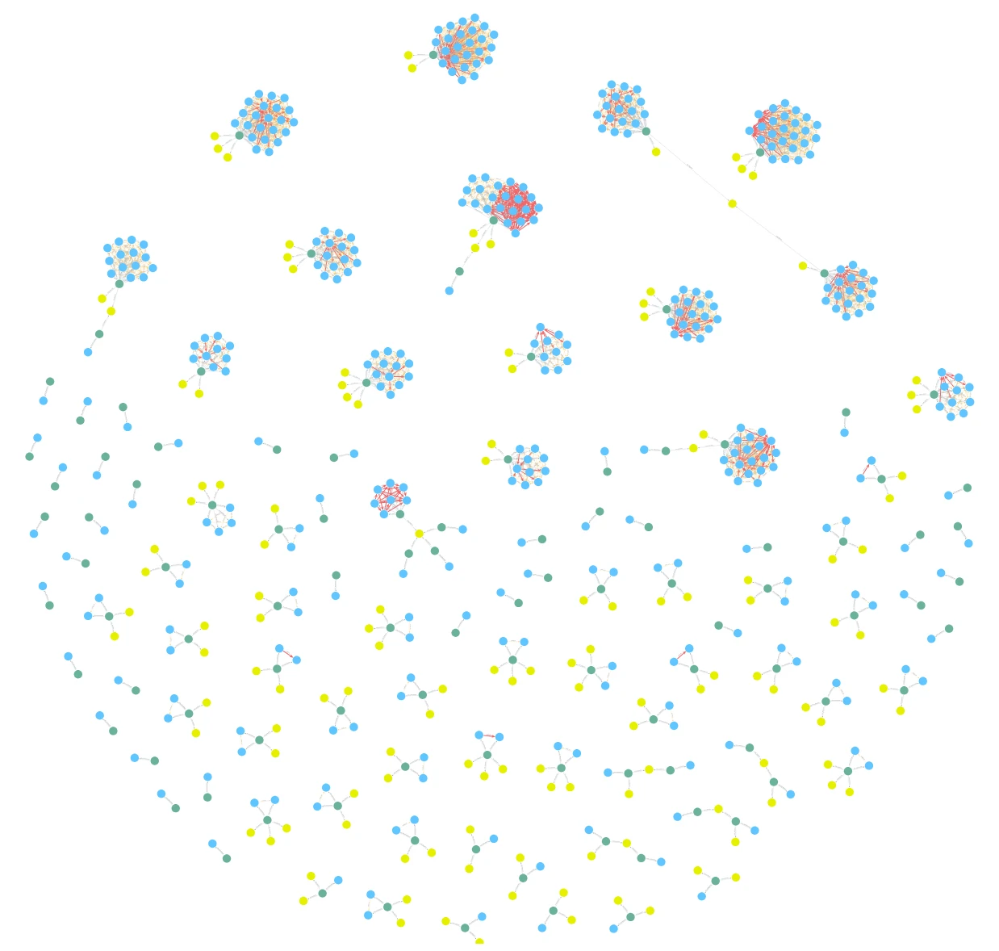
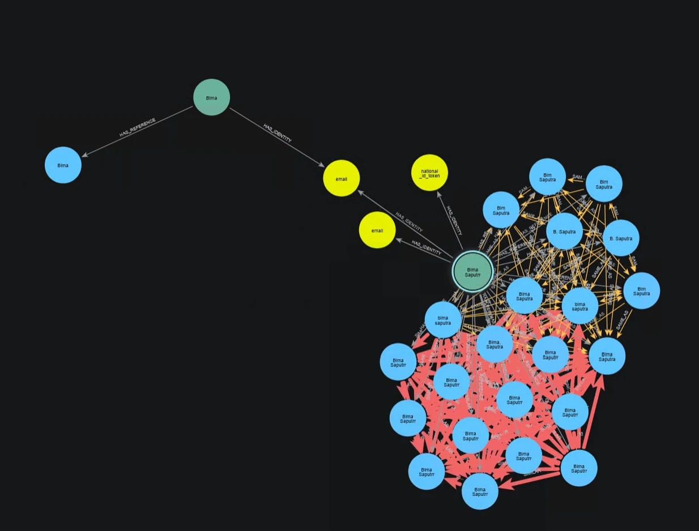
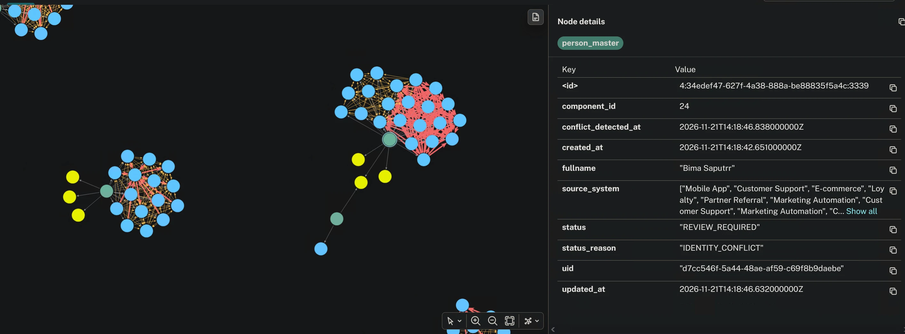

---
# Feel free to add content and custom Front Matter to this file.
# To modify the layout, see https://jekyllrb.com/docs/themes/#overriding-theme-defaults

layout: default
title: Identity Knowledge Graph
parent: Knowledge Graphs
grand_parent: Data Engineering
permalink: /graphs/identity/
nav_order: 102
---

# Identity Knowledge Graph

Identity
{: .badge .badge-pill .badge-primary }
graph
{: .badge .badge-pill .badge-secondary }
data
{: .badge .badge-pill .badge-info }

* Do not remove this line (it will not be displayed)
{:toc}



# Introduction
Organizations store information about the same real-world entities across different systems. These systems may use different identifiers, data structures, naming conventions, and levels of data quality. For example, a customer may exist in a CRM system, an ERP system, and a customer service platform. Each system may store a different customer ID, name format, address, or contact detail. The records may refer to the same person, even when their values are not identical. The challenge is to determine whether a record in one system has a corresponding record in another system. This process is known as **Entity Resolution (ER)**.

Entity Resolution identifies records that refer to the same real-world entity. It uses identifiers, attributes, comparison rules, and business logic to evaluate relationships between records. **Master Data Management (MDM)** uses the results of entity resolution to maintain consistent and trusted records across systems. It establishes a persistent representation of each recognized entity, often called a master record or golden record.

An Identity Knowledge Graph provides a graph-based structure for this process. It represents source records as nodes and their matching evidence as relationships. This structure allows the system to identify identity groups, inspect matching evidence, and maintain relationships between source records and master entities. The graph also provides traceability. Each master entity can link to its original source records and the evidence used to associate them.

# When Does the Problem Appear?
There are several scenarios where you may face duplicated data. Some of the most common are:

- **Data integration**: this is probably the most frequent case. Different applications store variants of the same data for different functions, but often the data from multiple systems needs to be combined for analytics purposes. That data is collected and managed independently. This results in records being identified and described in different ways by each, without consistent strong identifiers across systems.

  > Any analytic workload (analysis, reporting, predictive model building) of the integrated data is unreliable without first having solved the duplication problem.

- **Anonymous activity**: many publicly accessible systems allow users to interact with them without authenticating (e.g., to browse products). 

- **Intentional/fraudulent duplicates**: sometimes duplicates are created intentionally when bad actors are trying to beat a system.

All these scenarios share the same fundamental question: given two records, do they refer to the same or to different entities?

# Graph-Based Entity Resolution

Graph-Based Entity Resolution uses graph structures and graph algorithms to identify records that refer to the same entity. The process represents each source record as a node. Relationships between nodes describe the matching results.

Two main relationship types support the matching process:

| Relationship | Purpose                 | Description                                                                                                          |
| ------------ | ----------------------- | -------------------------------------------------------------------------------------------------------------------- |
| `SAME_AS`      | Strong identity match   | Connects records that match on one or more strong identifiers.                                                       |
| `SIMILAR`      | Probable identity match | Connects records that have similar attribute values but do not have sufficient evidence for a direct identity match. |

The relationship properties store the evidence and scores used during matching.

For example:
- A matching national ID can create a `SAME_AS` relationship.
- Similar full names can create a `SIMILAR` relationship.
- A matching year of birth can increase the similarity score.
- A large difference in year of birth can reduce the similarity score.

The matching process combines these results to identify connected identity groups.

# Core activities
The process consists of four main activities:
- **Data ingestion**: Collect records from different source systems and load them into the graph.
- **Data preparation**: Clean, standardize, and validate the source attributes.
- **Entity matching**: Compare records and create relationships based on matching rules and evidence.
- **Master entity curation**: Create, update, and maintain persistent master records from the matching results.

Each activity has a defined responsibility. Data ingestion establishes the source records. Data preparation improves their quality. Entity matching identifies possible identity relationships. Master entity curation consolidates the results into persistent records.

# Data Ingestion
Data ingestion collects records from different source systems and loads them into the Identity Knowledge Graph.

The source systems may include:
- Customer Relationship Management (CRM) platforms.
- Enterprise Resource Planning (ERP) systems.
- Human Resource Information Systems (HRIS).
- Customer service platforms.
- Transactional databases.
- External reference datasets.
- Third-party data providers.

Each source record becomes a node in the graph. For example, a person record from a CRM system may contain a customer ID, full name, email address, phone number, and date of birth. A record from an ERP system may contain a different customer ID and a different set of attributes.The ingestion process must preserve the source identity and record lineage.

Example node properties include:

| Property    | Description                                      |
| ----------- | ------------------------------------------------ |
| source      | Name of the source system.                       |
| source_id   | Original record identifier in the source system. |
| person_id   | Internal identifier for the graph node.          |
| fullname    | Full name from the source record.                |
| email       | Email address from the source record.            |
| phone       | Phone number from the source record.             |
| yob         | Year of birth.                                   |
| ingested_at | Date and time when the record entered the graph. |
| updated_at  | Date and time of the latest source update.       |

Use a stable internal identifier for each source record. Preserve the original source ID and source system name. Do not replace source identifiers with generated master identifiers. A source record and a master entity serve different purposes. The ingestion process should also support incremental loading. This allows the system to process new and updated records without loading the complete source dataset on every execution.

# Data Preparation
The purpose of data preparation is to ensure that source attributes meet the quality requirements of the matching process. Differences in data types, formats, units, and naming conventions can produce incorrect matching results. Standardize these values before comparing records.

Data preparation should include the following activities.

## Data type alignment
Convert equivalent attributes into consistent data types.

Examples:
- Store dates in a consistent date format.
- Store year of birth as an integer.
- Store numerical measurements using a consistent numeric type.
- Store similarity scores as numeric values between 0 and 1.
- Store identifiers as strings when their leading zeros must be preserved.

Do not convert identifiers into numeric values especially the format carries meaning.

## Data standardization
Apply consistent formats to attributes that will be used during matching.

| Attribute     | Preparation rule                                                            |
| ------------- | --------------------------------------------------------------------------- |
| Full name     | Remove unnecessary spaces and apply consistent character formatting.        |
| Email         | Remove surrounding spaces and convert to lowercase.                         |
| Phone number  | Standardize country codes and remove formatting characters.                 |
| Date of birth | Convert to a consistent date format.                                        |
| National ID   | Remove permitted formatting characters and preserve leading zeros.          |
| Address       | Standardize abbreviations, postal codes, and location names where possible. |

Standardization must follow the business rules for each attribute. Do not remove characters that form part of a valid identifier.

## Data cleansing
Identify and handle values that can reduce matching quality. Common data quality issues include:

- Missing values.
- Invalid identifiers.
- Duplicate source records.
- Incorrect data types.
- Inconsistent formats.
- Placeholder values.
- Conflicting attribute values.

Missing values must not be treated as matching values. For example, two records with a null email address must not match because both values are null. The process should also distinguish between an empty value and a valid value. An empty string must not be treated as a valid identifier.

## Feature preparation
Select the attributes that will support entity matching. Group the attributes according to their matching purpose.

| Feature group            | Examples                                | Matching purpose                                         |
| ------------------------ | --------------------------------------- | -------------------------------------------------------- |
| Strong identifiers       | National ID, passport number, tax ID    | Identify records with high-confidence evidence.          |
| Weak identifiers         | Full name, email, phone number, address | Identify records with approximate or incomplete matches. |
| Non-identifying features | Year of birth, gender, city, occupation | Support or reduce confidence in a possible match.        |

**The classification depends on the business domain and data governance rules.** For example, an email address may be a useful weak identifier, but it is not always unique to one person. A phone number may be shared by multiple people. A national ID may provide stronger evidence, subject to its validity and uniqueness requirements. Prepare all matching features before running the entity matching process.

## Blocking keys
Optionally, the data preparation phase may include the generation of blocking keys. Blocking is a technique to reduce the search space and so improve performance.

When looking for duplicates, you will need to compare every record to every other record requiring $n^2$ operations for n elements. For large datasets, do not compare every record with every other record. This creates a large number of candidate pairs and can increase processing time. To reduce this to a more manageable computational workload, you need to avoid comparing pairs that are not likely to produce matches. This is the job of the blocking keys. Only candidates with the same blocking key are compared with each other. Sometimes features in the data can be used as blocking keys. 

Use candidate generation or blocking to reduce the number of comparisons. Possible blocking keys include:
- First characters of normalized names.
- Postal code.
- Birth year.
- Phonetic name keys.
- Country and region.
- Other stable attributes.

Blocking improves performance, but it can reduce recall if the blocking rules are too restrictive. Test the rules against known matching records.

# Entity Matching
Entity matching determines whether two source records refer to the same real-world entity. The matching rules must reflect the business requirements and the reliability of each attribute. The process uses three main comparison methods:
1. Exact matching.
2. Approximate matching.
3. Rule-based similarity score adjustment.

## Strong identifier matching
Strong identifier matching compares attributes that are expected to identify an entity with a high degree of confidence.

Examples include:
- National identification number.
- Passport number.
- Tax identification number.
- Other validated unique identifiers.

When two records from different source systems have the same valid strong identifier, the process creates a `SAME_AS` relationship. The matching process should support multiple strong identifiers through a configurable feature list.

Example:

```cypher
MATCH (p1:Person), (p2:Person)
WHERE p1.source <> p2.source
  AND elementId(p1) > elementId(p2)
  AND p1.ssn IS NOT NULL
  AND trim(p1.ssn) <> ''
  AND p1.ssn = p2.ssn
MERGE (p1)-[r:SAME_AS]-(p2)
SET r.ssn_match = true;
```

with configuration such as;

```json
strong_identifiers = [
    "ssn",
    "passport_no",
    "national_id",
    "tax_id"
]
```

The process generates the matching conditions from this configuration. Two generated components support this process:

- `match_conditions`: Generates the Cypher WHERE conditions for the selected strong identifiers.
- `match_evidence`: Generates relationship properties that record which identifiers matched.

This evidence supports later validation and audit activities. A strong identifier match should not be accepted without checking its validity, source reliability, and uniqueness rules. A shared or incorrectly assigned identifier can create false identity relationships.

## Weak identifier matching
Weak identifier matching compares attributes that can vary between source systems. Examples include:
- Full name.
- Email address.
- Phone number.
- Address.
- Organization name.

Unlike strong identifiers, weak identifiers do not always provide an exact match. The process must calculate a similarity score and compare it with a configured threshold. For string attributes, the process can use the `Jaro-Winkler algorithm`.

Neo4j APOC provides the function:

```cypher
apoc.text.jaroWinklerDistance(value1, value2)
```

This function returns a distance:
- 0 means an exact match.
- A higher value means a larger difference.
- A value closer to 1 means a lower degree of similarity.

Convert the distance into a similarity score:

```python
similarity = 1 - distance
```

Example:

```cypher
MATCH (p1:Person), (p2:Person)
WHERE p1.source <> p2.source
  AND elementId(p1) > elementId(p2)
  AND NOT (p1)-[:SAME_AS]-(p2)
  AND p1.m_fullname IS NOT NULL
  AND p2.m_fullname IS NOT NULL

WITH p1, p2,
     1 - apoc.text.jaroWinklerDistance(
         toLower(trim(p1.m_fullname)),
         toLower(trim(p2.m_fullname))
     ) AS similarity

WHERE similarity >= 0.80
MERGE (p1)-[r:SIMILAR]-(p2)
SET r.sim_score = similarity;
```

The threshold is configurable. A threshold of 0.80 accepts candidate pairs with a similarity score of at least 0.80. The matching process must also exclude pairs that already have a `SAME_AS` relationship.

## Similarity score adjustment
Weak identifier matching produces an initial similarity score. Additional attributes can increase or reduce confidence in the candidate match. This process uses a `rule-based score adjustment`.

It applies two types of correction:
- **Boosting**: Increase the score when an additional feature supports the match.
- **Damping**: Reduce the score when an additional feature does not support the match.

The adjustment uses numerical and string comparison methods.

- **Numerical feature comparison**: For numerical attributes, calculate the absolute difference between two values.

  Example: Example: year of birth.

  ```cypher
  abs(p1.m_yob - p2.m_yob)
  ```

  A small difference may support a match. A large difference may reduce confidence. The threshold, boost factor, and damping factor must be configurable for each feature. The threshold determines whether the feature supports or reduces the score.

  Example:

  ```cypher
  feature_config = {
      "m_yob": {
          "type": "numeric",
          "threshold": 2,
          "boost": 1.10,
          "damp": 0.90
      }
  }
  ```

-  **String feature comparison**: For string attributes, use a string similarity algorithm such as Jaro-Winkler. A feature score at or above the threshold increases the overall similarity score. A score below the threshold reduces it. Missing or invalid values should follow an explicit policy. Do not automatically treat missing evidence as a positive match. For email and phone numbers, apply field-specific normalization before comparison. Jaro-Winkler is not always the best method for these attributes.

  Example:

  ```cypher
  1 - apoc.text.jaroWinklerDistance(
      toLower(trim(p1.m_fullname)),
      toLower(trim(p2.m_fullname))
  )
  ```

  Example configuration:

  ```cypher
  feature_config = {
      "m_fullname": {
          "type": "string",
          "threshold": 0.90,
          "boost": 1.10,
          "damp": 0.90
      },
      "m_email": {
          "type": "string",
          "threshold": 0.95,
          "boost": 1.10,
          "damp": 0.90
      }
  }
  ```

## Score adjustment calculation
The relationship stores the original score, the feature evidence, the adjustment factors, and the final score. We could define a maximum score of 1.0 for each calculation to cap the similarity value.

A simplified calculation is:

```
adjusted_score = base_score × factor_1 × factor_2 × ... × factor_n
```

For example:

```
base_score = 0.90

YOB boost = 1.10
Full name boost = 1.10
Email damping = 0.90

adjusted_score = 0.90 × 1.10 × 1.10 × 0.90
adjusted_score = 0.9801
```

Example - The `SIMILAR` relationship should preserve the following properties:

| Property            | Description                                |
| ------------------- | ------------------------------------------ |
| base_sim_score      | Initial score before adjustments.          |
| yob_diff            | Absolute difference in year of birth.      |
| fullname_similarity | Full name similarity.                      |
| email_similarity    | Email similarity.                          |
| sim_score           | Final adjusted similarity score.           |

The relationship can also store the applied thresholds and scoring configuration version. This supports reproducibility when matching rules change. Do not repeatedly adjust an already adjusted score. Calculate the final score from the original `base_sim_score` on each execution.

The multiplicative scoring method is a heuristic. It does not produce a calibrated match probability. Correlated attributes can also inflate the score. Validate the scoring rules against labeled matching and non-matching records.

## Remove relationships below the minimum score
After score adjustment, remove candidate relationships that do not meet the minimum similarity requirement score. The minimum score must be configurable from input process.

Example:

```cypher
MATCH (p1:Person)-[sim:SIMILAR]->(p2:Person)
WHERE sim.sim_score < $sim_score_threshold
DELETE sim;
```

For example:

```cypher
sim_score_threshold = 0.80
```

The process removes relationships below 0.80 and retains relationships at or above 0.80. A null similarity score should be handled separately. It should not be treated as a valid candidate match. This filtering step reduces weak or unsupported connections before the graph clustering stage.

# Build and Maintain Persisted Master Entities
The matching process creates relationships between source records. It does not, by itself, create persistent master entities. The master entity curation stage converts the matching results into a maintained representation of each real-world entity.

The process uses the Weakly Connected Components (WCC) algorithm from Neo4j Graph Data Science. WCC identifies groups of nodes that are connected through the selected relationships. In this workflow, `SAME_AS` and accepted `SIMILAR` relationships define the identity graph.

## Project the identity graph
Create a GDS graph projection from:
- Person nodes.
- `SAME_AS` relationships.
- `SIMILAR` relationships.

Use undirected relationships for the projection because identity connections are logically symmetric. The projection provides the graph structure required by WCC.

Example projection:

```cypher
G, result = gds.graph.project(
    "identity-wcc",
    "Person",
    {
        "SAME_AS": {"orientation": "UNDIRECTED"},
        "SIMILAR": {"orientation": "UNDIRECTED"}
    }
)
```

## Run WCC
Run WCC to identify connected identity groups.

```cypher
wcc_result = gds.wcc.write(
    G,
    write_property="wcc_component_id")
```

The algorithm assigns a component ID to each node. Records within the same component are connected through one or more identity relationships.

A component can contain:
- Two or more records connected by strong identifiers.
- Records connected through weak identifier matches.
- A combination of strong and weak matching relationships.
- A single isolated record with no matching relationships.

The component ID is a calculation result. It should not be treated as a permanent master entity identifier.

## Create or update `Person_Master` nodes
Use the WCC component assignments to create or update master records. Use a stable master identifier, such as a UUID. Do not use the WCC component ID as the permanent master identifier because component assignments can change after recalculation. 

The process follows these rules:

| Condition                                              | Action                                 |
| ------------------------------------------------------ | -------------------------------------- |
| Component has no existing master                       | Create a new `Person_Master`              |
| Component has exactly one existing master              | Reuse that master                      |
| Component has multiple existing masters                | Stop and flag for master consolidation |
| One existing master appears in multiple new components | Stop and flag for master splitting     |

The last two conditions matter when recalculating WCC. Automatically choosing a master in these cases can create incorrect identity assignments.

Create a `HAS_REFERENCE` relationship between each master and its original source records.

Example graph structure:

```
(PersonMaster)
      |
      | HAS_REFERENCE
      |
   (Person)
      |
      | SAME_AS / SIMILAR
      |
   (Person)
      |
      | HAS_REFERENCE
      |
(PersonMaster)
```

The actual graph should connect each source node to one active master entity.

## Build golden-record properties
A master entity should contain selected attributes from its source records. This consolidated record is commonly called a `golden record`.

The process must define a survivorship rule for each attribute. A survivorship rule determines which source value becomes the preferred master value. Do not select a preferred value based only on the first record returned by the database. Define an explicit priority and tie-breaking rule. Store the selected value and its source information. The master should also retain links to the source records. This preserves lineage and supports future corrections.

Possible rules include:
- Prefer verified source records.
- Prefer the most trusted source system.
- Prefer the most recently updated valid value.
- Prefer values with higher completeness.
- Apply a defined source priority.
- Flag conflicting values for manual review.

Example:

| Attribute     | Survivorship rule                                          |
| ------------- | ---------------------------------------------------------- |
| Full name     | Prefer a verified record from the highest-priority source. |
| Email         | Prefer the latest valid and verified email.                |
| Phone         | Prefer the latest verified phone number.                   |
| Date of birth | Prefer the value from the most trusted source.             |
| Address       | Prefer the latest valid address from an approved source.   |

## Maintain identity references
Create separate identity reference nodes for identifiers that must be managed across source records.

Examples include:
- National ID.
- Passport number.
- Tax ID.
- Other approved identity references.

Use an `Identity_Reference` node to represent each unique identifier.

Example graph structure:

```
(PersonMaster)
      |
      | HAS_IDENTITY
      |
(IdentityReference {
    type: "SSN",
    value: "123456789"
})
```

A composite uniqueness constraint on identifier type and value helps prevent duplicate identity reference nodes. The process should validate identifiers before creating references. It should also apply the required privacy and access controls because identity values may contain sensitive personal information.

## Detect identity conflicts
A master entity may contain conflicting identity values. For example, a master connected to several source records may contain two different national ID values. The process should group identity references by type and count distinct values. If one master has multiple values for the same identifier type, flag it for review. Do not resolve conflicting identity values by selecting one value without checking the source evidence.

Example:

```
PersonMaster
    |
    +-- IdentityReference: SSN = 123456789
    |
    +-- IdentityReference: SSN = 987654321
```

The master should receive a review status:

```
status = "REVIEW_REQUIRED"
status_reason = "IDENTITY_CONFLICT"
```

# Recalculation and Incremental Updates
Identity Knowledge Graphs must support changes in source data and matching relationships. New records, updated attributes, and deleted relationships can change the identity groups.

For example:
- A new source record may connect to an existing identity group.
- A new strong identifier match may connect two existing groups.
- A corrected attribute may remove a weak match.
- A change in the similarity threshold may remove or create relationships.
- A deleted relationship may split one connected component into multiple components.

The system must therefore support recalculation and master reconciliation.

## Incremental data processing
When new source data arrives:
- Load new or updated nodes - create new nodes and their source attributes.
- Run matching rules for the affected records - generate new `SIMILAR` and `SAME_AS` relationships.
- Create or update `SAME_AS` and `SIMILAR` relationships.
- Recalculate affected similarity scores.
- Remove relationships below the minimum threshold.
- Create a fresh GDS projection - include all Person nodes and their current identity relationships.
- Recalculate WCC - Write the new `wcc_component_id` values.
- Reconcile the new component assignments with existing masters - reuse existing masters where possible. Create masters for new components. Stop for unresolved merges or splits.
- Refresh golden-record properties and identity references - Update preferred attributes, identity references, and conflict status.
- Detect and report conflicts.

This approach supports recalculation when new records or relationships change the identity graph. It also handles isolated new people by creating a master for each new component.

**Important limitation**: The supplied implementation deliberately stops when an existing master must be merged or split. Those operations need a separate master-consolidation or master-splitting policy. Do not automatically delete duplicate masters or move their references without defining how to preserve their identity history, audit records, and downstream references.

Others additional implementation:
- A unique constraint on `Person_Master.uid`.
- A unique constraint on (`Identity_Reference.type`, `Identity_Reference.value`).
- An execution ID and timestamp for each WCC run.
- A reconciliation audit record containing old and new component assignments.
- A controlled process for master merges and splits.
- A policy for handling identity-reference changes and historical values.

## Master consolidation
A new relationship may connect two components that already have different master records.

For example:

```
Before:

PersonMaster A              PersonMaster B
     |                           |
   Person 1                    Person 2

             NEW SAME_AS
          Person 1 -- Person 2

After WCC:

        One connected component
```


The reconciliation process must identify both existing masters. A master consolidation policy must determine:
- Which master identifier remains active.
- Which master becomes a duplicate or retired record.
- How source references are reassigned.
- How downstream systems are notified.
- How the merge decision is recorded.

Do not silently discard an existing master record. Preserve its history and references according to the MDM governance policy.

## Master splitting
A deleted or invalid relationship may split an existing component.

For example:

```
Before:

          PersonMaster A
                 |
          Person 1 -- Person 2

After relationship removal:

          Person 1       Person 2
```

The system must identify that the previous master now spans multiple components. Create or assign separate masters according to the splitting policy. Preserve the original master and its history for audit purposes.

## Recalculation strategy
For smaller and medium-sized graphs, a full WCC recalculation may be simpler to maintain and validate. For larger graphs, consider an incremental strategy that identifies affected components and recalculates only the relevant subgraphs.

However, connected-component changes can propagate through an entire identity group. A local update is not always sufficient. The selected strategy must account for both component merges and component splits.


# Additional Concepts
##  Batch Processing and Execution Control
The workflow must support batch processing to manage memory usage and transaction size. Use a configurable batch size. The correct value depends on graph size, transaction duration, memory usage, and database capacity. 

Separate the processing into stages:

| Stage | Operation                   | Processing method                      |
| ----- | --------------------------- | -------------------------------------- |
| 1     | Data ingestion              | Incremental loading or batch ingestion |
| 2     | Data preparation            | Python data processing                 |
| 3     | Strong identifier matching  | Cypher with configurable rules         |
| 4     | Weak identifier matching    | Cypher with candidate blocking         |
| 5     | Score adjustment            | Configurable feature rules             |
| 6     | Weak relationship filtering | Batched relationship deletion          |
| 7     | Graph projection            | Neo4j GDS                              |
| 8     | WCC calculation             | Neo4j GDS                              |
| 9     | Master reconciliation       | Batched Cypher transactions            |
| 10    | Golden-record enrichment    | Batched Cypher transactions            |
| 11    | Conflict detection          | Cypher validation                      |
| 12    | Audit and monitoring        | Execution logs and metrics             |


Start with sequential processing for master reconciliation. This reduces the risk of concurrent batches attempting to update the same master entity.

Use transaction retries only for errors that are safe to retry. Make each stage idempotent so that a failed execution can resume without creating duplicate records or relationships.

## Data Governance and Quality Controls
Entity resolution affects customer identity, reporting, analytics, and operational systems. Incorrect matching can combine different entities into one master record. Missing matches can create duplicate master records. Apply quality controls throughout the process.

### Matching quality
Monitor:
- Strong identifier match rate.
- Weak identifier match rate.
- Candidate pair count.
- Similarity score distribution.
- False positive rate.
- False negative rate.

Number of records requiring manual review.

### Master data quality
Monitor:
- Number of active master entities.
- Average source records per master.
- Number of isolated records.
- Number of conflicting identity references.
- Number of masters with incomplete attributes.
- Number of duplicate master candidates.
- Number of master merges and splits.

### Traceability
Store enough information to explain each matching decision. Recommended information includes:
- Source record identifiers.
- Matching relationship type.
- Matching attributes.
- Feature evidence.
- Base similarity score.
- Applied adjustment factors.
- Final similarity score.
- Matching configuration version.
- Processing timestamp.
- Execution ID.
- Master reconciliation history.

**Restrict access to sensitive identifiers. Use masking or encryption where required by the organization's security and privacy policies.**

## Expected Outputs
The Identity Knowledge Graph produces three main outputs.

1. Identity relationships - The graph contains `SAME_AS` and `SIMILAR` relationships. Each relationship stores the matching evidence and relevant scores.
2. Identity groups - WCC identifies connected groups of source records. Each group represents a candidate identity group based on the configured matching rules.
3. Persisted master entities - The system creates and maintains `Person_Master` nodes. Each master links to its original source records and associated identity references. The master stores selected golden-record attributes and its current status.

These outputs support downstream applications such as:
- Customer 360.
- Master Data Management.
- CRM integration.
- Customer deduplication.
- Cross-system identity mapping.
- Customer analytics.
- Fraud and risk analysis.
- Enterprise knowledge graphs.

## Ouput examples





## Scripts

### Data ingestion
Run `main.py` file that read the csv files and config `graph_schema.json` to ingest the data into neo4j graph database.

```python
python main.py
```

### Data preparation
Assume the data already clear using external process (e.g. python and pandas).

### Entity matching
- Creating `SAME_AS` relationships between nodes matching on strong IDs
  
```python
  result = gds.generate_same_relations([URI, NEO4J_DATABASE, USERNAME, PASSWORD], target_label="person", source_system='source_system', identifiers = ["national_id_token"])
```

- Creating `SIMILAR` relationships between nodes matching on weak IDs

```python
  result = gds.generate_similarity([URI, NEO4J_DATABASE, USERNAME, PASSWORD], target_label="person", threshold=0.90, identifiers = "full_name", source_system='source_system', similar_relation= "SIMILAR", same_relation="SAME_AS")
```

- Boosting or damping `SIMILAR` relationships between nodes matching on weak IDs when they differ on other features

```json
feature_config={
    "yob": {
        "type": "numeric",
        "threshold": 2,
        "boost": 1.1,
        "damp": 0.9
    },
    "address_line": {
        "type": "string",
        "threshold": 0.95,
        "boost": 1.1,
        "damp": 0.9
    },
    "email": {
        "type": "string",
        "threshold": 0.95,
        "boost": 1.1,
        "damp": 0.9
    },
    "location": {
        "type": "string",
        "threshold": 0.95,
        "boost": 1.1,
        "damp": 0.9
    },
    "longitude": {
        "type": "numeric",
        "threshold": 0.05,
        "boost": 1.1,
        "damp": 0.9
    },
    "latitude": {
        "type": "numeric",
        "threshold": 0.05,
        "boost": 1.1,
        "damp": 0.9
    },
  }
```

```python
  result = gds.update_similar_score([URI, NEO4J_DATABASE, USERNAME, PASSWORD], feature_config=feature_config, target_label="person", max_score=1.0)
```

- Removing `SIMILAR` relationships between nodes matching on weak IDs when below minimum score

```python
  result = gds.update_relationship([URI, NEO4J_DATABASE, USERNAME, PASSWORD], target_label="person", sim_score_threshold = 0.90, batch_size=1000)
```

### Master entity curation

```python
  result = gds.wcc_algorithm([URI, NEO4J_DATABASE, USERNAME, PASSWORD])
```

## Important Design Considerations
A connected component is not automatically a confirmed real-world identity. WCC uses graph connectivity. It does not evaluate whether every pair of records in a component has sufficient matching evidence.

For example:

```
Person A -- SIMILAR -- Person B -- SIMILAR -- Person C
```

A and C belong to the same connected component, even if there is no direct matching relationship between them. This is a transitive grouping effect. It can produce incorrect identity groups when weak relationships connect unrelated records.

To control this risk:
- Use strict thresholds for weak matching.
- Validate strong identifier uniqueness.
- Review large or unusual components.
- Monitor conflicting identifiers within each component.
- Apply business rules before master consolidation.
- Use manual review for ambiguous identity groups.
- Consider relationship confidence and component consistency checks.
- Do not treat WCC as a substitute for matching validation.

Also distinguish between a candidate identity group and a confirmed master entity. The system should support a review status when the evidence does not meet the required confidence level.


# Conclusion
Graph-Based Entity Resolution combines data integration, data preparation, matching rules, graph algorithms, and master data curation.

The process begins by loading source records into a graph. It standardizes the attributes used for matching and compares records through strong and weak identifiers.

The matching process creates `SAME_AS` relationships for strong identity evidence and weighted `SIMILAR` relationships for approximate matches. Additional features can adjust similarity scores through configurable boosting and damping rules.

After filtering weak relationships, Neo4j Graph Data Science runs WCC to identify connected identity groups.

The system then creates or updates `Person_Master` nodes, links source records to their masters, applies golden-record survivorship rules, and maintains identity references.

Recalculation is part of the design. New data and changed relationships can merge or split identity groups. The master reconciliation process must handle these changes without losing source lineage or creating duplicate master assignments.

The result is a persistent Identity Knowledge Graph that provides traceable identity relationships and a controlled foundation for Master Data Management.


