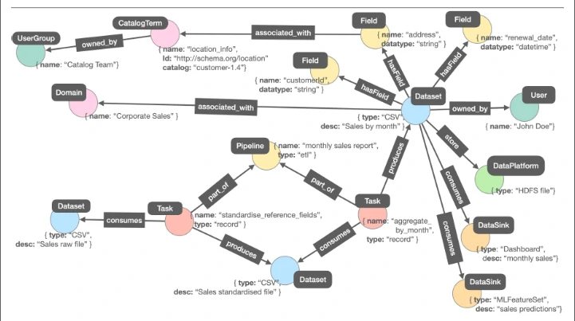
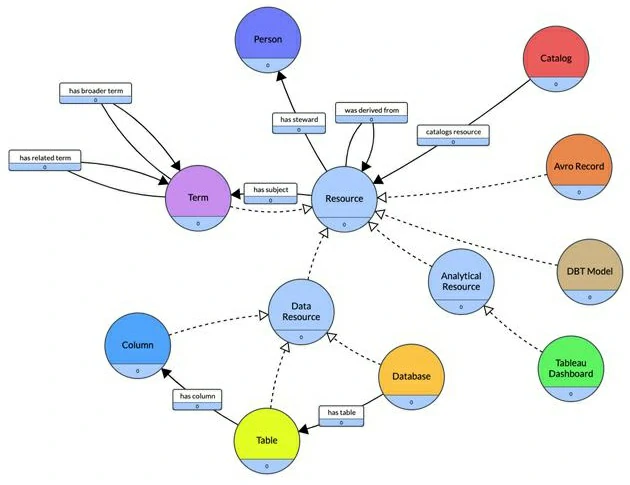
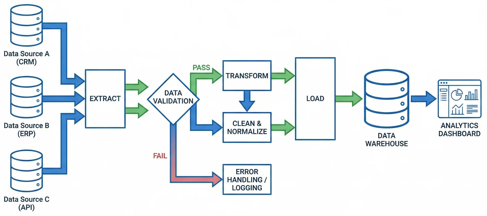
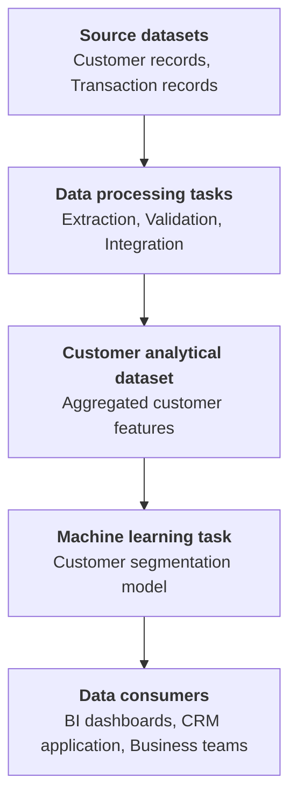
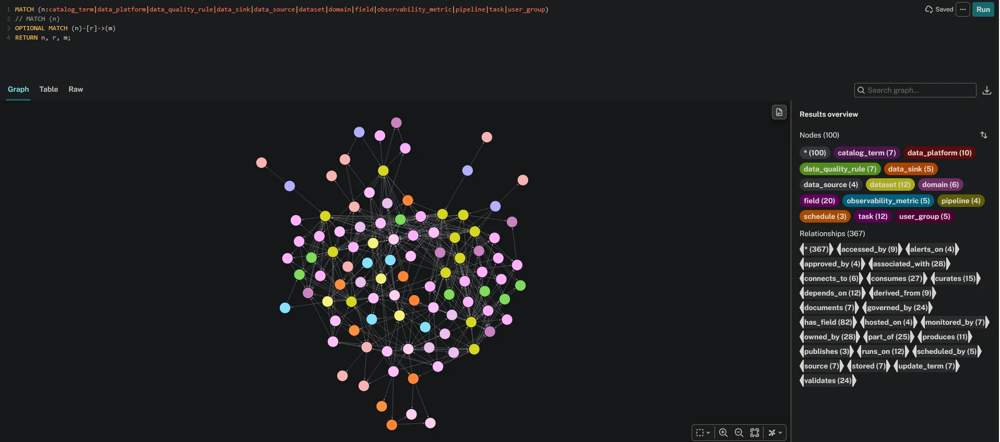

---
# Feel free to add content and custom Front Matter to this file.
# To modify the layout, see https://jekyllrb.com/docs/themes/#overriding-theme-defaults

layout: default
title: Metadata Knowledge Graph
parent: Knowledge Graphs
grand_parent: Data Engineering
permalink: /graphs/metadata/
nav_order: 101
---

# Metadata Knowledge Graph

metadata
{: .badge .badge-pill .badge-primary }
graph
{: .badge .badge-pill .badge-secondary }
data
{: .badge .badge-pill .badge-info }

* Do not remove this line (it will not be displayed)
{:toc}

# Introduction
A Metadata Knowledge Graph provides an enterprise-wide representation of an organization's data ecosystem. It maps data assets, data platforms, processing activities, and data consumers into a connected structure.

Traditional metadata management focuses on documenting individual data assets, such as database tables, files, columns, and systems. However, metadata becomes more valuable when these assets are connected through their relationships.

A Metadata Knowledge Graph extends conventional metadata management by connecting three fundamental components:
- Data: What data exists, how it is structured, and where it is stored.
- Processes: How data is created, transformed, validated, and transferred.
- Consumers: Which applications, teams, and users access or consume the data.

These relationships provide a clear representation of how data moves across the organization. They also establish data provenance, making it possible to trace data from its original source through processing activities to its final consumers.

The graph acts as a foundational layer for enterprise data management. It provides a consistent view of data assets, their dependencies, and their usage across different platforms.

By integrating technical metadata, operational metadata, and business metadata into a knowledge graph, organizations can make their data ecosystem easier to understand, monitor, and govern.



# Core Components of a Metadata Knowledge Graph
A dataset represents any structured or unstructured collection of data. Examples include database tables, CSV files, documents, APIs, data streams, and machine learning datasets.

Each dataset is associated with a data platform that stores, processes, or provides access to the data. A data platform can include a relational database, data warehouse, data lake, cloud storage, or external data service.

A dataset can also be described through its fields. Each field represents an individual data element within the dataset and defines part of its public schema.

Field metadata can include:
- Field name and description.
- Data type and format.
- Primary key or foreign key information.
- Nullable or mandatory constraints.
- Business definition and classification.
- Data sensitivity and classification level.

Connecting datasets to data platforms and fields establishes the structural foundation of the metadata graph.

This relationship allows organizations to identify where datasets are stored, understand their schemas, and determine how individual fields relate to other data assets.

## Example:
A dataset named `customer_transactions` is stored in a PostgreSQL data warehouse. It contains fields such as `transaction_id`, `customer_id`, `transaction_date`, and `transaction_amount`.

The graph represents these connections:
- The data platform stores the dataset.
- The dataset contains its field definitions.
- Each field can be associated with a business domain or catalog term.

This structure provides a consistent representation of the dataset, regardless of the system that stores it.



reference: https://data.world/blog/data-catalog-knowledge-graph/?utm_source=chatgpt.com

## Tasks and Data Pipelines
A task represents an individual data processing activity that operates on one or more data assets.

Tasks can perform different operations, including:
- Data extraction from source systems.
- Data validation and quality checks.
- Data transformation and enrichment.
- Data integration and aggregation.
- Feature engineering for machine learning.
- Data loading into target platforms.

A task can consume one or more datasets and produce new datasets as its output.

Multiple tasks can be connected to form a data pipeline or data flow. The connections between tasks define their execution order and dependencies.

By mapping tasks and pipelines into the knowledge graph, organizations can trace data transformations, identify upstream dependencies, and assess the impact of changes to processing activities. 

This also provides a foundation for operational monitoring and root-cause analysis when a data pipeline fails.



## Data Sinks and Data Consumers
A data sink represents a destination where processed data is delivered, stored, or consumed.

It can be a technical system, an analytical application, or a dataset used by downstream processes.

Common examples include:
- Business intelligence dashboards and reports.
- Machine learning training and inference datasets.
- Analytical data marts.
- APIs and application services.
- External data-sharing platforms.
- Operational reporting systems.

Mapping data sinks to their input datasets establishes visibility into how data is used across the organization. It also helps identify the relationship between data producers and consumers.

For example, a customer analytics dataset may serve multiple purposes:
- A Power BI dashboard uses the dataset for business performance reporting.
- A machine learning task uses the dataset to train customer segmentation models.
- A customer relationship management application uses the dataset to support customer profiling.

Although these applications consume the same underlying data, they represent different downstream use cases.

Connecting data sinks to datasets and processing tasks makes these dependencies explicit. Organizations can use this information to identify affected applications when a dataset changes, determine which consumers depend on a particular data asset, and evaluate the potential impact of removing or modifying a dataset.

## Data Ownership and User Groups
Data ownership defines the organizational responsibility for managing and maintaining data assets. A user group represents a team, department, or organizational unit that owns, manages, or consumes specific data assets.

Examples include:
- Data Engineering.
- Data Science and Analytics.
- Business Intelligence.
- Finance.
- Marketing.
- Operations.
- IT and Data Governance.

Connecting user groups to datasets, platforms, and tasks provides visibility into organizational responsibilities. This relationship supports data governance by identifying who manages a dataset, who maintains a processing pipeline, and which teams depend on specific data assets. It also helps organizations establish accountability for data quality, access control, documentation, and lifecycle management.

## Business Domains and Catalog Terms
Technical metadata describes the structure and operation of data. Business metadata provides the context required to understand what the data represents. A business domain groups data assets according to their business functions or subject areas.

Examples include:
- Customer.
- Finance.
- Sales.
- Supply Chain.
- Human Resources.
- Operations.

A catalog term defines a business concept, metric, or standardized definition associated with a dataset or field. For example, the term `Customer Lifetime Value` can be associated with customer transaction records and analytical datasets. These relationships connect technical data structures with business definitions.

As a result, users can discover data through business concepts instead of relying only on database names or technical field identifiers. This creates a shared understanding of enterprise data across technical and business teams.

# Relationships Between Metadata Components
The value of a Metadata Knowledge Graph comes from the relationships between its entities. Instead of maintaining separate metadata records, the graph connects datasets, fields, platforms, tasks, pipelines, data sinks, user groups, domains, and catalog terms.

The following relationships establish the main connections:

| Relationship    | Description                                                                                |
| --------------- | ------------------------------------------------------------------------------------------ |
| has_field       | Connects a dataset to its field definitions.                                               |
| stored          | Connects a dataset to the platform where it is stored.                                     |
| source          | Identifies the source dataset or system used by a task.                                    |
| consumes        | Connects a task or consumer to the data it uses.                                           |
| produces        | Connects a task to the dataset it generates.                                               |
| part_of         | Groups tasks into a pipeline or connects assets to a broader structure.                    |
| owned_by        | Identifies the responsible user group or organizational owner.                             |
| associated_with | Connects metadata entities with related business or technical concepts.                    |
| curates         | Identifies the user group responsible for maintaining a data asset.                        |
| update_term     | Connects a metadata entity to a business catalog term that defines or updates its meaning. |

These relationships allow the graph to represent both technical dependencies and business context. For example, a dataset can be connected to its storage platform, processing tasks, downstream consumers, responsible team, and business definitions.This creates a connected metadata structure rather than an isolated inventory of data assets.

# Data Provenance and Lineage
Data provenance describes the origin, processing history, and destination of a data asset. In a Metadata Knowledge Graph, provenance is represented through the relationships between source datasets, processing tasks, intermediate datasets, and final consumers.

Consider a data pipeline that generates a customer segmentation dataset. Example: Customer Segmentation Data Lineage.



This lineage provides several capabilities:
- Source identification: Determine which original datasets contribute to an analytical output.
- Transformation tracking: Identify the processing tasks that modify or enrich the data.
- Dependency analysis: Identify which datasets and tasks depend on a particular asset.
- Impact analysis: Determine which downstream applications and consumers may be affected by a data change.
- Ownership tracking: Identify the teams responsible for the affected assets and processes.

Data lineage therefore becomes a queryable part of the enterprise metadata structure.

# Operational and Business Applications
A Metadata Knowledge Graph provides a foundation for several enterprise data management capabilities.

| Capability              | Application                                                                    |
| ----------------------- | ------------------------------------------------------------------------------ |
| Data discovery          | Find datasets, fields, platforms, and related business definitions.            |
| Data lineage            | Trace data from its source to downstream consumers.                            |
| Impact analysis         | Identify affected datasets, pipelines, and applications before making changes. |
| Data governance         | Track ownership, responsibilities, and data classifications.                   |
| Pipeline monitoring     | Identify task dependencies and processing relationships.                       |
| Data quality management | Connect quality checks and validation tasks to the datasets they assess.       |
| Access management       | Understand which user groups require access to specific data assets.           |
| Metadata search         | Discover data through technical attributes and business concepts.              |

These capabilities allow organizations to manage metadata as an interconnected enterprise resource. Instead of investigating each database, pipeline, or application separately, users can explore the relationships and retrieve information across the entire data ecosystem.

# Examples



## Contents
- `nodes/`: one CSV per node label. Each file has a `:ID(Entity)` column and an explicit `:LABEL` column.
- `relationships/relationships.csv`: one combined relationship file with typed `:START_ID(Entity)`, `:END_ID(Entity)`, and `:TYPE` columns.
- `metadata/node_manifest.csv`: node labels, file names, and record counts.
- `metadata/relationship_manifest.csv`: relationship types, record counts, and descriptions.
- `metadata/pipeline_stage_manifest.csv`: ordered view of the source-to-output process.

## Data size
- Nodes: 100 across 13 labels.
- Relationships: 365 across 24 relationship types.
- All node IDs are globally unique and use the shared Neo4j ID group `Entity`.

## End-to-end flow

`DataSource` -> `Dataset` -> `Task` -> `Dataset` -> `DataSink` -> `UserGroup`

Use `source` to connect an external source to its source dataset. Use `consumes` and `produces` to connect tasks to datasets. Use `depends_on` for task order. Use `stored` to connect datasets to their physical sinks. Use `accessed_by` to identify the consumer groups.

The data layers in this data are source, bronze, silver, and gold. The data uses CRM, ERP, payment, and web event data.

##  Data discovery queries

Support data discovery queries like “What’s the most popular corporate sales dataset containing customer location information?” One way to measure a dataset’s popularity is to count the ways in which the data is consumed, by the number of data sinks consuming the dataset.

```cypher
MATCH (d:dataset)
MATCH (f:field)
WHERE (d)-[:associated_with]->(:domain{name:'sales'})
  AND (d)-[:has_field]->(f:field)-[:associated_with]->(:catalog_term)
RETURN
  d.entity_id AS dataset_id,
  d.name AS dataset_name,
  f.entity_id AS field_id,
  f.name AS field_name,
  d.domain AS domain,
  count{(d)-[:stored]->(ds:data_sink)} AS dataset_usage_count
```

| dataset_id | dataset_name       | field_id | field_name | domain | dataset_usage_count |
| ---------- | ------------------ | -------- | ---------- | ------ | ------------------- |
| DS009      | bronze_sales_order | FLD003   | email      | sales  | 1                   |


## Explore the metadata graph to assess the impact of a failing task

```cypher
MATCH (t:task)-[:produces|consumes*2..5]-(d:dataset)-[:stored]-(s:data_sink)-[:accessed_by]->(o)
WHERE t.name ="extract_crm_customer"
RETURN DISTINCT
  t.entity_id AS task_id,
  d.entity_id AS dataset_id,
  s.entity_id AS affectedDataConsumerID,
  s.sink_type AS affectedDataConsumerType,
  o.entity_id AS ownerID,
  o.name AS ownerName
LIMIT 5
```

| task_id | dataset_id | affectedDataConsumerID | affectedDataConsumerType | ownerID | ownerName                  |
| ------- | ---------- | ---------------------- | ------------------------ | ------- | -------------------------- |
| TSK001  | DS006      | SNK001                 | object_storage           | GRP001  | data_engineering_team      |
| TSK001  | DS007      | SNK001                 | object_storage           | GRP001  | data_engineering_team      |
| TSK001  | DS008      | SNK001                 | object_storage           | GRP001  | data_engineering_team      |
| TSK001  | DS009      | SNK001                 | object_storage           | GRP001  | data_engineering_team      |
| TSK001  | DS010      | SNK002                 | postgresql_schema        | GRP002  | analytics_engineering_team |


## Data Lineage

```cypher
MATCH (s:data_sink)-[:stored]-(d:dataset)-[:produces|consumes*2..5]-(t:task)-[:runs_on]->(dp:data_platform)
WHERE s.name = "minio_bronze_bucket"
RETURN DISTINCT
  s.entity_id AS data_sink_id,
  s.name AS sink_name,
  d.entity_id AS dataset_id,
  d.name AS dataset_name,
  t.entity_id AS taskID,
  t.name AS task_name,
  dp.entity_id AS platformID,
  dp.name AS platform_name
LIMIT 5
```

| data_sink_id | sink_name           | dataset_id | dataset_name            | taskID | task_name                    | platformID | platform_name         |
| ------------ | ------------------- | ---------- | ----------------------- | ------ | ---------------------------- | ---------- | --------------------- |
| SNK001       | minio_bronze_bucket | DS006      | raw_payment_transaction | TSK008 | standardize_sales_order      | PLT009     | dbt                   |
| SNK001       | minio_bronze_bucket | DS006      | raw_payment_transaction | TSK005 | load_to_bronze               | PLT005     | dlt Ingestion Runtime |
| SNK001       | minio_bronze_bucket | DS006      | raw_payment_transaction | TSK006 | validate_bronze_data         | PLT009     | dbt                   |
| SNK001       | minio_bronze_bucket | DS006      | raw_payment_transaction | TSK002 | extract_sap_sales_data       | PLT005     | dlt Ingestion Runtime |
| SNK001       | minio_bronze_bucket | DS006      | raw_payment_transaction | TSK010 | aggregate_sales_performance  | PLT009     | dbt                   |


## Find the end-to-end task path

```cypher
MATCH (src:data_source)-[:source]->(raw:dataset)
MATCH (task:task)-[:consumes]->(raw)
MATCH (task)-[:produces]->(out:dataset)-[:stored]->(sink:data_sink)
RETURN 
  src.name, 
  raw.name, 
  task.name, 
  out.name, 
  sink.name
ORDER BY task.sequence
LIMIT 5
```

| src.name                  | raw.name            | task.name              | out.name           | sink.name           |
| ------------------------- | ------------------- | ---------------------- | ------------------ | ------------------- |
| CRM Customer REST API     | raw_crm_customer    | extract_crm_customer   | bronze_customer    | minio_bronze_bucket |
| SAP S/4HANA OData Service | raw_store_master    | extract_sap_sales_data | bronze_sales_order | minio_bronze_bucket |
| SAP S/4HANA OData Service | raw_erp_sales_order | extract_sap_sales_data | bronze_sales_order | minio_bronze_bucket |
| SAP S/4HANA OData Service | raw_erp_order_line  | extract_sap_sales_data | bronze_sales_order | minio_bronze_bucket |
| SAP S/4HANA OData Service | raw_erp_product     | extract_sap_sales_data | bronze_sales_order | minio_bronze_bucket |

## Find all datasets and their fields

```cypher
MATCH (d:dataset)-[:has_field]->(f:field)
RETURN d.name, collect(f.name) AS fields
ORDER BY d.name
LIMIT 5;
```

| d.name                       | fields                                                                                                                                                                     |
| ---------------------------- | -------------------------------------------------------------------------------------------------------------------------------------------------------------------------- |
| bronze_customer              | [source_system, customer_name, is_deleted, customer_created_at, email, customer_id, phone_number, ingestion_timestamp]                                                     |
| bronze_sales_order           | [email, quantity, ingestion_timestamp, net_amount, unit_price, product_id, payment_status, source_system, order_date, order_customer_id, order_id, store_id, order_status] |
| gold_customer_360            | [ingestion_timestamp, net_amount, customer_id, customer_created_at, customer_name, email, phone_number, source_system]                                                     |
| gold_sales_performance_daily | [store_id, net_amount, product_id, order_date]                                                                                                                             |
| raw_crm_customer             | [source_system, customer_name, customer_created_at, customer_id, ingestion_timestamp, is_deleted, phone_number, email]                                                     |

## Find pipeline dependencies

```cypher
MATCH (downstream:task)-[:depends_on]->(upstream:task)
RETURN upstream.name AS upstream_task, downstream.name AS downstream_task
ORDER BY downstream.sequence
LIMIT 5
```

| upstream_task                | downstream_task      |
| ---------------------------- | -------------------- |
| extract_crm_customer         | load_to_bronze       |
| capture_web_events           | load_to_bronze       |
| extract_sap_sales_data       | load_to_bronze       |
| extract_payment_transactions | load_to_bronze       |
| load_to_bronze               | validate_bronze_data |


## Maintenance rules
1. Add a new node label by creating a new CSV in `nodes/` and adding one row to `metadata/node_manifest.csv`. Keep `:ID(Entity)` and `:LABEL` in the header.
2. Use a unique ID prefix for each label, such as `DS`, `FLD`, or `TSK`. Do not reuse an ID.
3. Add relationships to `relationships/relationships.csv`. Every endpoint must match an existing node ID. Use a new `relationship_id` for every row.
4. Add each new relationship type and its description to `metadata/relationship_manifest.csv`.
5. Add a new property by adding a column to the relevant node CSV schema. Keep property names stable and use ISO 8601 for timestamps.
6. Keep business terms in `CatalogTerm`. Do not duplicate a business definition in multiple datasets.
7. Use `owned_by`, `associated_with`, `governed_by`, `scheduled_by`, and `monitored_by` to capture operational ownership and control.
8. Re-run referential integrity checks after every change.

## CSV conventions
- UTF-8 with BOM is used for spreadsheet compatibility.
- Empty values mean that the property is not set.
- Boolean values use `true` or `false`.
- `:LABEL` stores the Neo4j node label. `Entity` in `:ID(Entity)` is the shared ID group, not the node label.
- `:TYPE` stores the relationship type. Relationship types use the requested lowercase names.

## Graph Schema
- `graph_schema.json` defines every node label and every relationship type. Node CSV paths are relative to this directory. Relationship CSV files are split by type under `relationships/by_type/`, because each relationship entry in the schema declares one fixed type. The original combined file remains available at `relationships/relationships.csv`.
- All node CSV files use `:ID(Entity)` as the shared Neo4j ID-group column. The schema maps this value to the `entity_id` node property. Relationship endpoint columns use the same `Entity` ID group and resolve through `entity_id`.
- Each relationship uses `relationship_id` as its identity key. Property types are declared in the schema. Blank optional values are left blank in the CSV.
- Use `graph_schema.json` with the metadata-driven CSV loader. Resolve each CSV path relative to the dataset directory.

